<p align="center">
  
</p>

<h1 align="center">Demel</h1>

<p align="center">
  <strong>A private, self-hosted health dashboard for one person.</strong><br>
  Sleep, recovery, movement, food, hydration and longevity in one calm iPhone PWA,<br>
  fed by your Fitbit / Google Health data, with an AI coach that can log for you.
</p>

<p align="center">
  
  
  
  
  
</p>

<p align="center">
  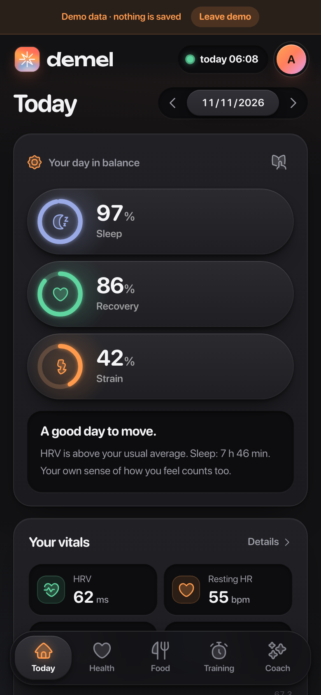
  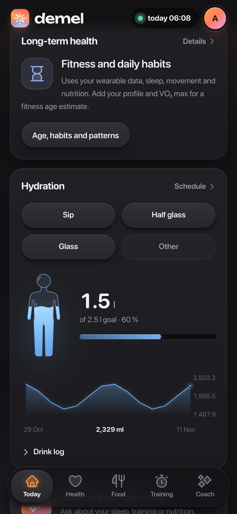
  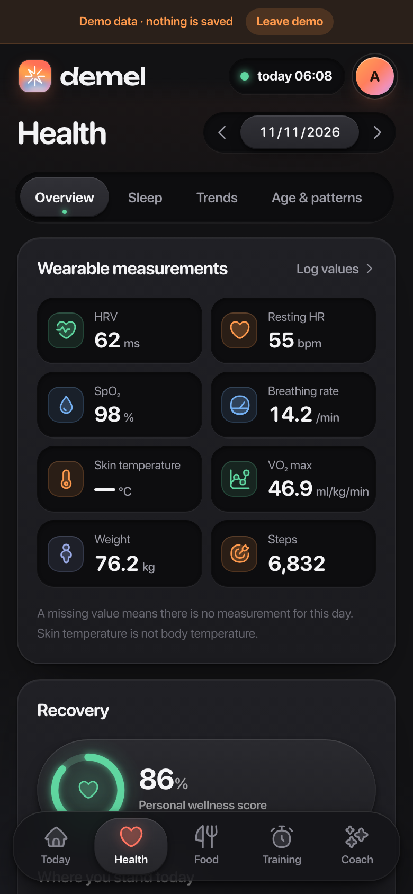
  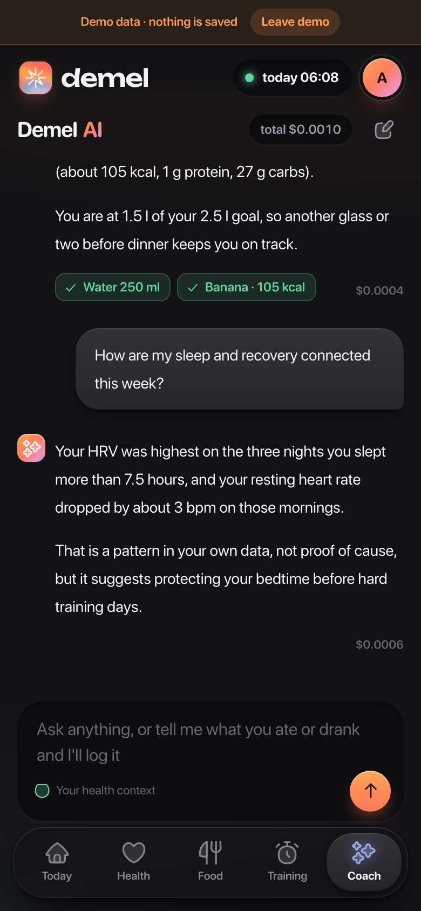
</p>

---

## Why Demel

Commercial health apps keep your data on their servers and hide how their scores work. Demel runs on your own machine (a mini PC, a home server, a VPS behind Tailscale), stores everything in one SQLite file, and shows exactly how every number is calculated. There is one user, one password and no tracking.

> All screenshots use the built-in demo mode with synthetic data. Nothing shown belongs to a real person.

## Features

**Today**
- Three score rings: **Strain**, **Recovery** and **Sleep**. Tap a ring for its detail page with a 7-day trend, its inputs and the method behind it.
- A daily physiology engine built on per-minute heart rate: heart-rate zones, Edwards TRIMP strain with a **target strain** based on your 14-day load and today's recovery, HRV/RHR-based recovery against your 30-day baseline, plus **Stress**, **Energy**, heart-rate recovery and training load.
- Short AI insight cards written from today's numbers (optional, only with an OpenRouter key).
- Vitals at a glance: HRV, resting heart rate, sleep and SpO₂, with a 14-day chart.

**Journal, Fitness and Biology**
- **Journal:** one-tap daily habits (yes/no), caffeine and alcohol amounts, illness, shown next to the following night's sleep and recovery.
- **Fitness:** training load, cardio fitness and per-session detail with zones and energy.
- **Biology:** a weekly **biological age** from the last 4 weeks across five categories (Sleep, Activity, Fitness, Lifestyle, Blood). Each factor comes from published hazard ratios, converted to years with the Gompertz mortality law, with an overlap correction and a confidence score per factor.

**Health**
- Overview of all wearable measurements: HRV, resting HR, SpO₂, breathing rate, skin temperature, VO₂ max, weight, steps and blood pressure.
- Sleep with stages and efficiency, 90-day trends and journal patterns.
- **All data:** a catalogue of 42 Google Health data types with daily summaries, every numeric field, per-type history and the original records (stored losslessly and compressed).
- **Age & patterns:** a VO₂ max fitness age (FRIEND 2022 reference), sleep debt, circular bedtime regularity, moderate-intensity minutes, protein per kg and energy balance, plus correlations between sleep, activity and HRV.
- Optional **Clinical PhenoAge** from 9 blood markers (Levine 2018), and storage for epigenetic clock results (Horvath, GrimAge, DunedinPACE and others).
- Daily check-in for mood, energy, stress, caffeine, alcohol, meditation and illness.

**Food & hydration**
- Food diary with calories, macros and fiber, a food library and saved portions.
- Describe a meal or snap a photo and the AI estimates the portion; you always review it before saving.
- Hydration with one-tap **Sip / Half glass / Glass** buttons. Drops fall into a human-figure vessel that fills up.
- An adaptive sip-reminder schedule that spaces reminders across your drinking window.

**Training**
- Workouts with exercises and sets, RPE, a stopwatch and a rest timer.
- Reusable plans, an exercise library and a fully paginated history.
- Strength volume chart; Fitbit activities sync in automatically.

**AI coach**
- A chat that sees a compact 30-day summary of your data and answers in the language you write in.
- It can **log for you**: "I just had two eggs and a coffee" becomes journal entries through validated tool calls (water, meals, workouts, check-ins, measurements; only today and the last 7 days).
- Every reply shows its **cost in USD** in the corner of the bubble, plus the total for the conversation.
- Works with any OpenRouter model. The recommended default is `anthropic/claude-haiku-5.5`: cheap, fast, reliable at tool calls and able to read food photos.

**Everything else**
- Google Health OAuth with token refresh, pagination, manual sync of up to 90 days and an automatic hourly sync. The last successful sync time is always visible.
- Web Push notifications with your own VAPID keys: a morning summary, an evening check-in, hydration and movement reminders.
- Installable PWA with an offline read-only copy (opt-in) and automatic updates when a new build is deployed.
- JSON export and import, plus daily consistent SQLite backups kept for 14 days.

<p align="center">
  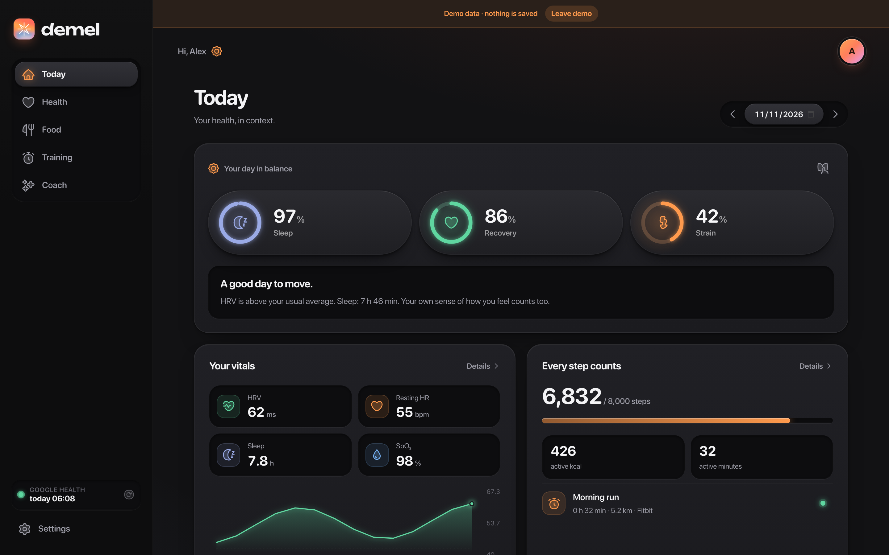
</p>

<details>
<summary><strong>More screenshots</strong></summary>
<br>
<p align="center">
  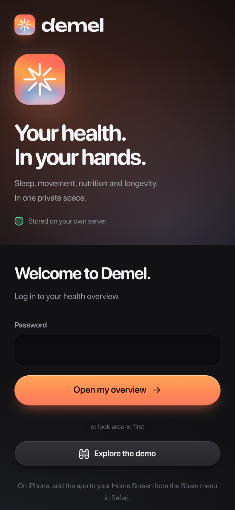
  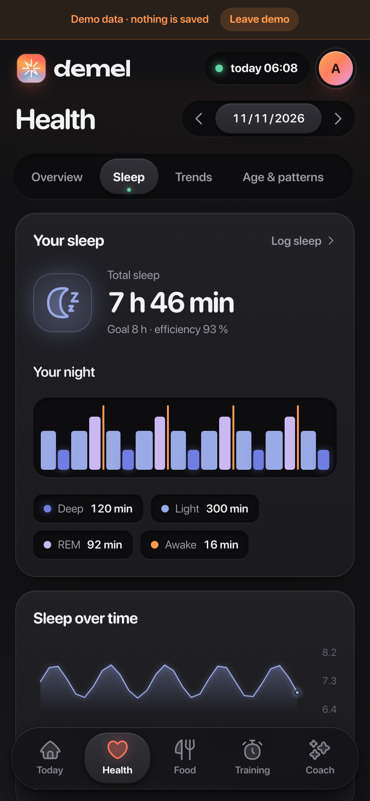
  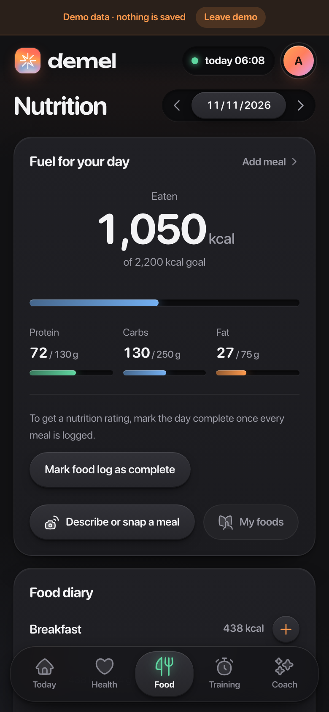
  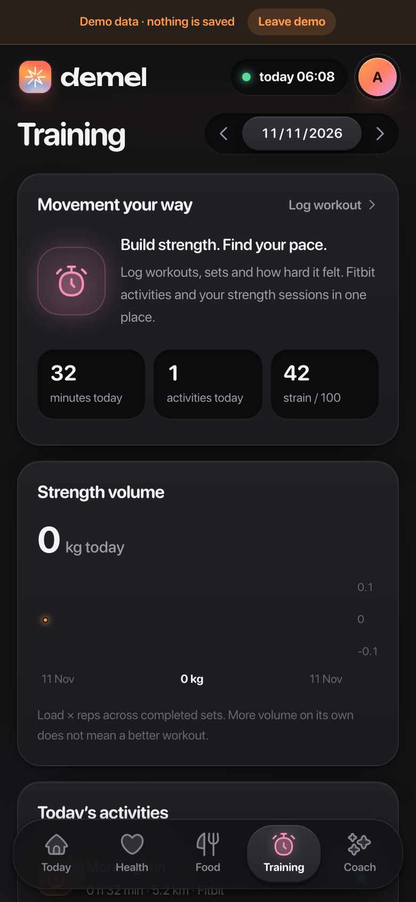
</p>
<p align="center">
  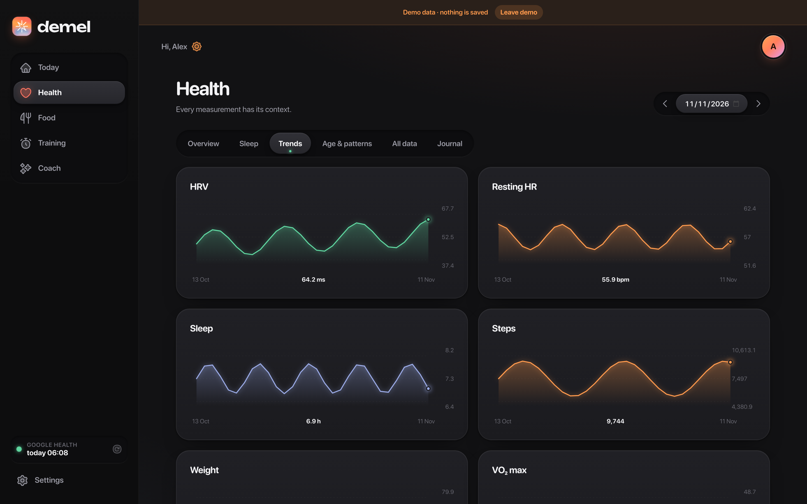
</p>
<p align="center">
  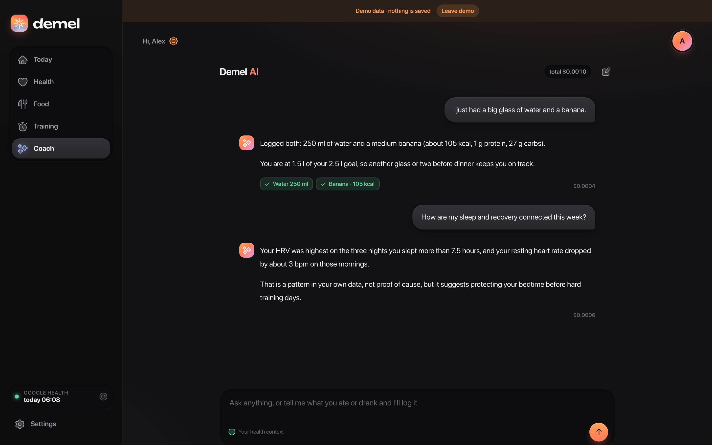
</p>
<p align="center">
  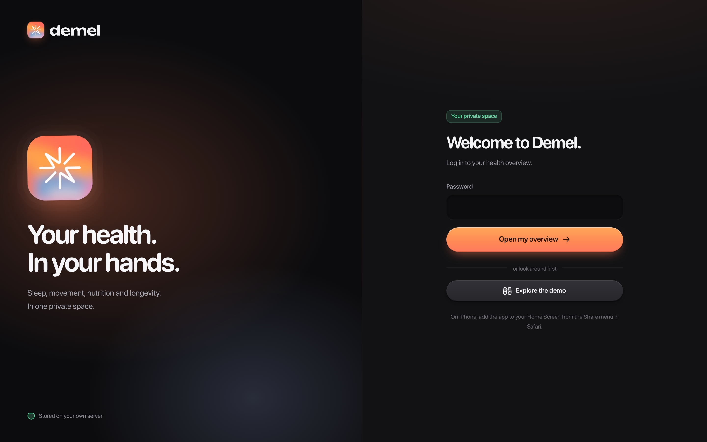
</p>
</details>

## How it works

```
iPhone PWA / browser
   │  HTTPS (e.g. Tailscale Serve)
   ▼
FastAPI + Uvicorn  ── serves the built frontend and the /api
   │        │
   │        ├── scheduler: hourly Google Health sync, push reminders, daily backup
   │        ├── Google Health API  (read-only OAuth)
   │        ├── OpenRouter API     (only with your key and explicit consent)
   │        └── Web Push           (Apple / Google / Mozilla push services)
   ▼
SQLite (WAL)  ── entries, daily Google archives, settings, encrypted secrets
```

- **Frontend:** vanilla TypeScript built with Vite. No framework; views are template strings with strict escaping, behind a strict Content-Security-Policy.
- **Backend:** FastAPI with pydantic validation on every write. One process; no Redis, queue or external database.
- **Scores:** plain Python in `backend/engine.py` (daily physiology), `backend/bioage.py` (biological age), `backend/scores.py`, `backend/analytics.py` and `backend/age.py`, covered by tests. Every score's method and references are also shown in the app. Formulas and sources are in [docs/SCIENCE.md](docs/SCIENCE.md).
- **Design:** a dark “bevel” design system with accents taken from the logo. Details in [docs/DESIGN.md](docs/DESIGN.md).

## Quick start (local)

Requirements: Python 3.12 and Node 22.

```sh
git clone https://github.com/greeenos/demel.git && cd demel
python3.12 -m venv .venv
.venv/bin/pip install -r requirements.txt
npm ci
.venv/bin/python bootstrap.py     # creates .env and ACCESS.txt (your first password)
npm run build
.venv/bin/python run.py           # http://127.0.0.1:8198
```

`bootstrap.py` runs once: it generates a random password (written to `ACCESS.txt`, mode 0600), its PBKDF2 hash and a Fernet encryption key in `.env`. It never overwrites an existing configuration. Use `VITAL_URL=https://your-host` when creating it to set the public origin. Change the password in **Settings → Security** after your first login.

Just want to look around? Open the app and tap **Explore the demo**. The demo runs entirely in the browser with synthetic data.

## Deploy with Docker

```sh
.venv/bin/python bootstrap.py          # or copy an existing .env
docker compose up -d --build
docker compose logs --tail 50 vital
```

The container:

- runs as UID 10001 with no Linux capabilities, `no-new-privileges` and a read-only root filesystem,
- has 256 MB RAM and 1 CPU, a health check on `/api/health`, and is bound to `127.0.0.1:8198`,
- writes only to `./data`.

Put HTTPS in front of it. With Tailscale this is one command:

```sh
tailscale serve --bg --https=10456 http://127.0.0.1:8198
```

Set `APP_URL` in `.env` to the exact public origin (scheme, host and port). It is used for the CSRF origin check, the OAuth redirect URI and the secure cookie flag.

## Connect Fitbit / Google Health

1. In Google Cloud, create a project, enable the **Google Health API** and create an OAuth client of type **Web application**.
2. Add the redirect URI shown in **Settings → Fitbit / Google Health** (`<APP_URL>/api/google/callback`) and add your Google account as a test user.
3. Paste the Client ID and secret into Settings, click **Connect Google account** and then **Load 90 days**.

Demel only requests read-only scopes: activity and fitness, sleep, health metrics, nutrition, irregular rhythm, ECG, profile and settings. Partial failures keep the successful parts, and every data type shows whether it is available, empty, missing a permission or unsupported by your device.

## AI coach (OpenRouter)

Add an OpenRouter API key and a model in **Settings → OpenRouter AI**, then turn on consent. Without both, no AI request is ever sent. Each question sends a 30-day summary, the last week of meals, workouts and check-ins, and recent chat turns to OpenRouter and the chosen provider; food photos are sent only when you use recognition. Responses request `usage.include`, so the exact cost of each message is stored next to it.

## Notifications on iPhone

Open the app in Safari → **Share → Add to Home Screen**, open it from the icon, then go to **Settings → Smart notifications → Enable on this device** and send a test. iOS Web Push needs the app installed on the Home Screen. Delivery times are best effort.

## Security and privacy

- Single user. Login uses PBKDF2-SHA256 (600k iterations), an HttpOnly SameSite cookie stored as a SHA-256 hash server side, and rate limiting.
- Every non-GET request is checked against `APP_URL` (CSRF), and request bodies are capped at 9 MB.
- Integration secrets (OpenRouter key, Google OAuth client and tokens, VAPID key) are encrypted at rest with Fernet.
- Strict CSP (`script-src 'self'`), `X-Frame-Options: DENY`, `no-referrer` and `nosniff`.
- No analytics, no third-party scripts, no fonts from a CDN.

Keep `.env` safe and backed up separately: without its `ENCRYPTION_KEY`, the stored integration secrets cannot be decrypted.

## Backups and restore

`data/vital.sqlite` uses WAL. A consistent copy made with the SQLite backup API is written to `data/backups/` every day and kept for 14 days. A backup on the same disk does not protect against disk failure, so copy it elsewhere.

To restore:

1. Stop only the app.
2. Back up the current `data/`.
3. Put the chosen backup in place as `data/vital.sqlite`.
4. Remove the old `-wal` and `-shm` files and restore ownership to UID 10001.
5. Start the app again and check `/api/health`.

The JSON export (Settings → Your data) restores health entries by ID; profile, chat and tokens come back only from a full database backup.

## Tests

```sh
.venv/bin/pip install pytest playwright && .venv/bin/playwright install chromium
.venv/bin/pytest -q          # backend: scores, PhenoAge, auth, sync, AI tools, regressions
npm run build                # type check + production build
```

The browser checks in `scripts/` need an isolated test backend. They create test records, so never point them at your real database:

```sh
DATA_DIR=data-browser APP_URL=http://127.0.0.1:8208 PORT=8208 \
APP_PASSWORD_HASH=... ENCRYPTION_KEY=... .venv/bin/python run.py
VITAL_TEST_URL=http://127.0.0.1:8208 VITAL_TEST_PASSWORD=... .venv/bin/python scripts/browser_check.py
```

`scripts/screenshots.py` regenerates the README screenshots from the demo.

## Project structure

```
backend/
  main.py           FastAPI app: auth, API routes, AI chat and tool loop
  models.py         pydantic models for every entry type
  scores.py         sleep / recovery / strain and daily aggregation
  analytics.py      fitness age, sleep debt, regularity, correlations
  age.py            Clinical PhenoAge and the study catalogue
  google_health.py  OAuth and sync
  google_data.py    lossless daily archive for 42 data types
  coach_tools.py    tools the AI coach may call to log entries
  hydration.py      adaptive sip-reminder schedule
  notifications.py  Web Push and the background scheduler
  db.py             SQLite helpers, encrypted secrets, backups
frontend/
  main.ts           state, actions, forms, motion system
  views.ts          screens
  insights.ts       Google data and long-term health views
  water.ts          hydration vessel and drop physics
  ui.ts             components, charts, wordmark
  icons.ts          generated Streamline duo icons
  style.css         the design system
public/             logo, PWA manifest, service worker
docs/               design system and scientific method
tests/              pytest suite
scripts/            browser checks, screenshots, icon export
```

## Credits

- Icons: [Streamline Flex](https://www.streamlinehq.com) (CC BY 4.0), recoloured.
- Wordmark: [Unbounded](https://fonts.google.com/specimen/Unbounded) (SIL Open Font License 1.1), converted to outlines.
- Fitness reference: Kaminsky et al., FRIEND registry, Mayo Clinic Proceedings 2022.
- PhenoAge: Levine et al., Aging 2018.

## Disclaimer

Demel is a personal wellness tool, not a medical device. Its scores are transparent heuristics, not diagnoses. Do not change medication, diet or training because of a number in this app without talking to a qualified professional. Lab results must be interpreted by a doctor.

## License

No open-source license has been chosen yet, so the code is © the author, all rights reserved. Third-party assets keep their own licenses (see Credits).
